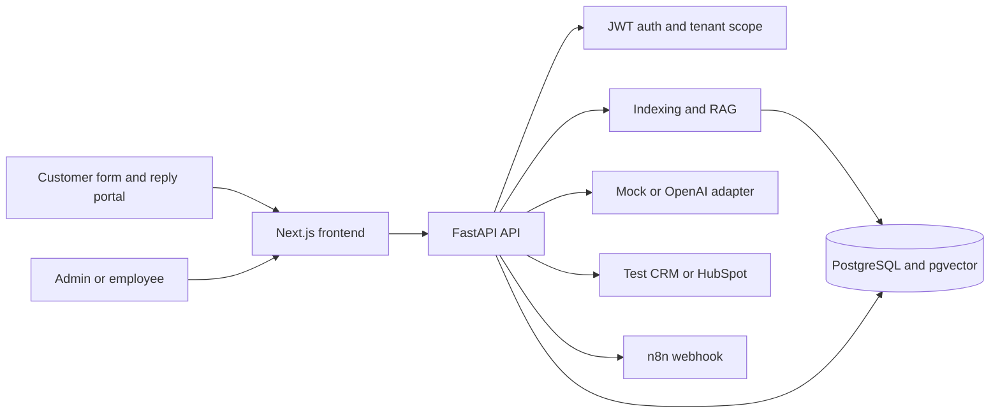

# LeadOps AI

LeadOps AI is a B2B inbox for customer inquiries. It reads a company knowledge base, classifies each message, prepares a reply with source passages, and waits for a person to approve the text. After approval it publishes the reply in the customer portal, syncs the inquiry to CRM, and calls an n8n webhook.

The repository is independent from AgentForge. It reuses three architectural ideas from that project: small provider adapters, a local mode that works without API keys, and PostgreSQL vector search for production. It does not import AgentForge packages or depend on its agent engine.

## What is included

- Email and password authentication with administrator and employee roles
- Organizations with scoped queries for every business record
- PDF upload, public URL indexing, and pasted text
- PostgreSQL with pgvector and an HNSW cosine index
- Local deterministic embeddings and optional OpenAI embeddings
- Mock and OpenAI LLM adapters
- Inquiry classification by category, intent, and urgency
- RAG drafts with confidence and stored source passages
- Edit, approve, send, assign, regenerate, and escalate actions
- A customer reply portal protected by reference and email
- Test CRM records and a HubSpot adapter for contacts plus tickets or deals
- n8n webhooks with HMAC signing, error logging, and manual retry
- Dashboard analytics and a tenant-scoped activity log
- Demo organization, users, knowledge, inquiries, and CRM data

## Architecture



The backend derives `organization_id` from the authenticated user. It does not trust an organization identifier sent by the browser. Every tenant-owned table includes `organization_id`; `organizations` is the tenant root and is the only exception. Cross-organization access returns `404` so the API does not confirm that another tenant's record exists.

## Start with Docker Compose

You need Docker with the Compose plugin.

```bash
cp .env.example .env
```

Replace `POSTGRES_PASSWORD`, `JWT_SECRET`, and `N8N_ENCRYPTION_KEY` in `.env`. These commands generate suitable local values:

```bash
openssl rand -hex 32
openssl rand -hex 32
openssl rand -hex 32
```

Use one output for each setting, then start the stack:

```bash
docker compose up --build
```

Open these addresses:

- LeadOps AI: `http://localhost:3000`
- FastAPI docs: `http://localhost:8000/docs`
- n8n: `http://localhost:5678`

The backend runs the Alembic migration and creates the demo workspace on its first start.

## Demo account

The sign-in form is prefilled with the administrator account:

```text
Organization: demo-leadops
Email: admin@demo.leadops.ai
Password: DemoLeadOps2026!
```

There is also an employee account:

```text
Email: agent@demo.leadops.ai
Password: DemoLeadOps2026!
```

All seeded organizations, users, sources, inquiries, messages, drafts, CRM records, and log entries have `is_demo=true`. The interface shows a Demo badge on seeded records.

## Prepare the n8n demo webhook

On the first n8n start, create the local owner account at `http://localhost:5678`. Import `n8n/workflows/leadops-demo.json`, then publish the workflow. Its production webhook path is:

```text
http://n8n:5678/webhook/leadops-demo
```

In LeadOps AI, open Integrations, save that URL under n8n, and enable webhook delivery. The URL uses the Docker service name because the backend calls n8n inside the Compose network.

The workflow returns the inquiry reference in its response. n8n keeps the execution so the webhook can be checked from both the Automations page and the n8n execution list.

## Demo scenario

1. Sign in as the demo administrator.
2. Open Knowledge base and upload a PDF or paste a short policy.
3. Open Settings and launch the public form.
4. Submit a customer inquiry that the new source can answer.
5. Return to Inbox and open the new inquiry.
6. Check the classification, confidence, and quoted source passages.
7. Edit the draft and click Save edit. This clears any previous approval.
8. Click Approve, then Send reply.
9. Confirm the Test CRM record and n8n status in the success message.
10. Open Automations to inspect the webhook or retry a failed delivery.
11. Open Activity log to see the intake, RAG, approval, send, CRM, and webhook actions.
12. From the public form confirmation, open Check reply status and enter the customer's email. The approved reply is now visible in the customer portal.

This covers the full demo without an LLM key or HubSpot account. Mock mode is deterministic and performs real retrieval over the indexed knowledge base. It is meant for local development, tests, and product walkthroughs.

## Run without Docker

PostgreSQL and pgvector are the intended application database. SQLite support exists for tests and quick backend work.

Backend:

```bash
cd backend
python3.12 -m venv .venv
source .venv/bin/activate
pip install -r requirements.txt
cp .env.example .env
uvicorn app.main:app --reload --port 8000
```

Frontend:

```bash
cd frontend
corepack enable
pnpm install
cp .env.local.example .env.local
pnpm dev
```

## Real OpenAI mode

Set these values in `.env`:

```text
LLM_PROVIDER=openai
EMBEDDINGS_PROVIDER=openai
OPENAI_API_KEY=your-key
OPENAI_MODEL=gpt-4o-mini
```

OpenAI embeddings use `text-embedding-3-small` with the configured `EMBEDDING_DIM`. Keep one embedding dimension per database. Reindex existing sources if the provider or dimension changes.

## HubSpot setup

Create a HubSpot private app with contact read and write scopes plus ticket or deal write access. In Integrations, choose HubSpot, enter the private app token, and select whether an approved inquiry creates a ticket or a deal.

The adapter uses HubSpot's date-versioned `2026-03` CRM endpoints. It looks up the contact by email, creates or updates the contact, creates the selected CRM object, and adds the default association between them. The token is encrypted before storage and is never returned by the API.

## Tests

Backend:

```bash
cd backend
source .venv/bin/activate
pytest
```

The test suite covers:

- Cross-organization access
- Document chunking and embeddings
- RAG source persistence
- Approval before send and customer portal delivery
- Failed n8n webhook retry

Frontend:

```bash
cd frontend
pnpm typecheck
pnpm lint
pnpm build
```

## API and data flow

The public intake endpoint creates the conversation and customer message in one transaction. Classification and RAG draft generation run immediately for the MVP. A production deployment with large files should move indexing and LLM work to a queue, while preserving the same service boundaries.

Sending is deliberately separate from approval. Editing an approved draft returns it to `draft` status and clears the approval fields. The send endpoint refuses any draft that is not currently approved.

CRM and webhook failures do not erase the sent customer reply. They produce error log entries. A failed webhook also keeps its payload, target, response, and attempt count for a later retry.

## Secrets and production notes

- Keep `.env` out of version control. The repository ignores it.
- Replace all example secrets before exposing the app outside a local machine.
- HubSpot tokens and n8n signing secrets are encrypted at rest.
- The current JWT is stored in browser local storage. For an internet-facing deployment, move authentication behind secure, HTTP-only cookies and add CSRF protection.
- URL indexing blocks private and local network addresses by default to reduce SSRF risk.
- Application queries enforce tenant separation. Add PostgreSQL row-level security before serving tenants that require database-level isolation.
- Background jobs, email delivery, subscriptions, voice, WhatsApp, and additional CRMs are outside this MVP.

